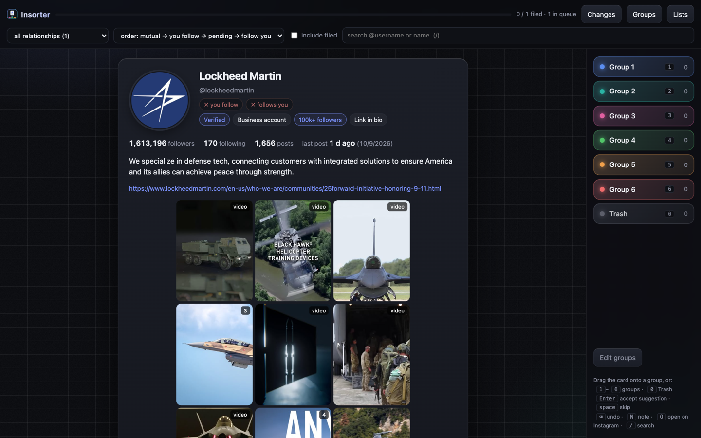
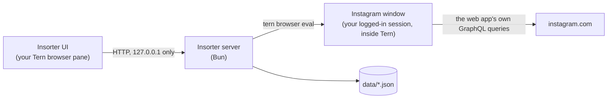

<p align="center">
  
</p>

<p align="center">
  <em>In</em>stagram + <em>sorter</em>: the people you follow and the people who follow you, dealt one card at a time into the groups you define.<br>
  Local. Read-only. Your groups, your words.
</p>

<p align="center">
  <a href="LICENSE"></a>
  
  
  
</p>

---

## Why

One Instagram account ends up holding every circle of your life: family, close friends, coworkers, the hacker crowd, the hobby you don't discuss at work. Splitting it into one profile per bubble means deciding, for thousands of accounts, *who belongs where* — and Instagram gives you a list with no tools.

Insorter turns that into a fast, Tinder-style triage: a card per account, with everything you need to decide (bio, posts, who in your network follows them, whether they follow you back), and your own groups as targets. Drag, press a key, done. The result is a set of lists you can act on later, by hand.

Third-party "who unfollowed me" apps ask for your password and run on someone else's servers. Insorter never sees your password, never writes to your account, and never leaves your machine.

## What it does

- **Collects** your following, followers and pending follow requests (read-only), and shows which direction each relationship goes.
- **Triage cards** with avatar, name, bio, link, counts, last post date, a 3×4 grid of recent posts, and *"followed by @a, @b and N more from your network"* — the strongest signal for which bubble someone belongs to.
- **Flags** that speed up decisions: mutual · follows you · you follow · asked to follow you · close friend · favorite · restricted · muted · verified · private · business · category · city · pronouns · 10k+/100k+ followers · follows 2k+ · nobody from your network · recent story · link in bio · inactive for N years · no posts · possible scam · no profile picture.
- **Your groups, your words**: create up to 9 numbered groups (plus a *Trash* action on key 0). Each group can carry keywords (surname, city, profession, hashtag…); when a card matches, it shows a suggestion you accept with <kbd>Enter</kbd>. Nothing about your life is hardcoded.
- **Tinder mechanics**: drag the card and it tilts and gets stamped with the group under the pointer; release to file it. Or press <kbd>1</kbd>–<kbd>9</kbd>. Undo anything. The next card waits underneath.
- **Auto-sort by your rules**: once groups have keywords, file every undecided account that matches them in one go (preview first, choose how many words must match). Auto-filed accounts are flagged so you can review them in the lists or re-triage just those.
- **Changes since last time**: every new collection is diffed against the previous one — who unfollowed you, new followers, new follow requests, who you stopped following — with the option to file them straight from that view.
- **Notes** per account ("ex-coworker from X", "met at the conference"), searchable in the lists and exported with the decisions.
- **Lists view** per group with search, multi-select to move or remove in bulk, "copy @s", and export per group as CSV (with notes) and as a plain `.txt` of usernames.
- **Pace**: how many you filed today, your current cards-per-minute and an estimate of how long the rest of the queue takes.
- **Everything local**: a Bun server on `127.0.0.1`, JSON files in `data/`, nothing sent anywhere except the requests the Instagram web app itself makes.

<p align="center"></p>
<p align="center"><sub>The card above is the public Instagram profile of Lockheed Martin as Insorter renders it, with the viewer's own relationship and network data left out. Groups are whatever you name them; here, <em>Group 1</em> to <em>Group 6</em> plus <em>Trash</em>.</sub></p>

**Try it without an account**: `bun start` and open `http://127.0.0.1:47380/?demo=1`. Demo mode serves a synthetic dataset from memory and never reads `data/`: a placeholder version of the same company card, followed by generated accounts. No private person appears anywhere in this repository.

## How it works



The Instagram session lives in a browser window inside [Tern](https://stencil.so/tern). Insorter asks that window, through Tern's automation bridge, to run the same two GraphQL queries the Instagram web app runs when you open a profile (`PolarisProfilePageContentQuery`, `PolarisProfilePostsQuery`) and the same list endpoints the followers dialog uses. Tokens (`fb_dtsg`, `lsd`, CSRF) and query ids are read from the page at call time, so nothing is copied out of the session and nothing goes stale.

There is no code path that follows, unfollows, accepts, blocks or messages anyone. Insorter is a reading and sorting tool; acting on the lists is up to you.

## Requirements

- macOS with [Tern](https://stencil.so/tern) (the Instagram window and the UI run as Tern browser panes; `tern` must be on your `PATH`).
- [Bun](https://bun.sh) ≥ 1.1.
- An Instagram account you own. Insorter only reads data that account can already see.

## Quick start

```sh
git clone https://github.com/Luidiblu/insorter.git
cd insorter
bun install

bun run collect   # opens Instagram inside Tern; log in THERE; reads your lists (a few minutes)
bun start         # serves the UI on http://127.0.0.1:47380
```

Open `http://127.0.0.1:47380/` in a Tern browser pane (for example from a pane: `tern browser '{"op":"open","owner":"@focused","url":"http://127.0.0.1:47380/"}'`, then `tern dock <block> right`). The first screen asks you to create your groups.

Collection is paced (about 1.5–2 s per request) and Instagram often serves followers 25 at a time, so count roughly a minute per thousand accounts. Every page is checkpointed: if the run is interrupted — throttling, the window closed, your laptop asleep — run `bun run collect` again and it resumes where it stopped (checkpoints live in `data/collect-cache.json` for three hours). Run it again whenever you want fresh lists; decisions are keyed by account id and survive re-collection.

## Logging in safely

This is the part most "Instagram tools" get wrong, so here is exactly what Insorter does and what you should do.

**What Insorter does**

- It never asks for your username or password and has no place to type them. `bun run collect` opens `instagram.com` in a Tern browser window and *waits*. You log in there, in Instagram's own page, including two-factor authentication.
- It detects the session only by the presence of Instagram's public `ds_user_id` cookie in that window. The session cookie itself (`sessionid`) is `HttpOnly`: Insorter cannot read it, and does not try.
- It never stores credentials, cookies or tokens on disk. Request tokens are read from the page each time a query runs and discarded.
- It talks to the Instagram window only through `tern browser` (Tern's automation bridge), with read-only queries, at most one request per second.

**What you should do**

- Type your password only inside the Instagram window. Not in a terminal, not in a chat, not in a config file. If an assistant or a script asks for it, the answer is no.
- Keep two-factor authentication on. Insorter works fine with it.
- Treat the machine as the secret: the Tern browser profile keeps the Instagram session like any browser would. Lock your screen; don't run Insorter on a shared account.
- When you are done for good, log that session out from Instagram: *Settings → Accounts Center → Password and security → Where you're logged in*, or simply log out in the Tern window.
- Don't commit `data/`. It is git-ignored and contains other people's names and avatar URLs; keep it private even though it holds no credentials.

**Rate limits and etiquette**

Insorter paces every request (≥ 1 s between calls, pauses on HTTP 429) and only fetches what a human would see by opening a profile. Keep it that way: one card at a time, no bulk scans, no automation on top of it. A burst of thousands of requests is how accounts get temporary action blocks.

## What is stored

| File | Content | Sensitive? |
|---|---|---|
| `data/accounts.json` | usernames, names, avatar URLs, relation flags | other people's public data — keep private |
| `data/profiles.json` | cache of bios, counts, post thumbnails | same |
| `data/decisions.json` | which group you put each account in | your judgement about people — keep private |
| `data/config.json` | your groups and keywords | personal |
| `data/notes.json` | your notes per account | your words about people — keep private |
| `data/meta.json` | when you last collected, your account id | low |
| `data/changes.json` | the diff between the last two collections | same as accounts |
| `data/collect-cache.json` | checkpoints of a collection in progress (removed when it completes) | same as accounts |
| `data/exports/*.csv`, `*.txt` | what you export | same as decisions |

No credentials, cookies or tokens are ever written. The whole `data/` directory is git-ignored.

## Keyboard and gestures

| Action | Key / gesture |
|---|---|
| File into group 1–9 | <kbd>1</kbd>–<kbd>9</kbd>, click the group, or drag the card onto it |
| Trash (special action) | <kbd>0</kbd> |
| Accept the keyword suggestion | <kbd>Enter</kbd> |
| Skip (moves to the end of the queue) | <kbd>Space</kbd> |
| Undo | <kbd>Backspace</kbd> or the toast button |
| Add or edit the note | <kbd>N</kbd> (<kbd>Enter</kbd> saves, <kbd>Esc</kbd> cancels) |
| Open the profile in the Instagram window | <kbd>O</kbd>; click a thumbnail to open that post |
| Search | <kbd>/</kbd> |

Filters: by relationship (mutual, you follow, they follow you, pending), by name, and "include filed" to re-triage (optionally one group, or only the auto-filed ones). Orders: mutuals → you follow → pending → they follow you (default), suggestions first, or alphabetical. `?demo=1` loads the synthetic dataset instead of your data.

## Limitations

- **Tern only, for now.** The bridge to the logged-in window is `tern browser`. A driver over plain Chromium (CDP) is the next step and would make Insorter usable without Tern.
- **Unofficial endpoints.** Insorter replays the queries Instagram's own web client runs. Meta changes them without notice; when a card says the live profile is unavailable, open an issue with the error text.
- **Instagram's Terms of Use** prohibit automated access, even to your own data. Insorter is read-only, paced like a human, and runs inside your own browser session, but using it is your call and your risk.
- **No "since when".** The API does not expose when a follow happened; only Instagram's *Download your information* export has it.

## Development

```sh
bun test            # pure logic: suggestions, validation, CSV, collection diff
bun run typecheck   # tsc over src/
bun start           # server, reads data/ (PORT and INSORTER_DATA override the port and the data directory)
```

Layout: `src/server.ts` (HTTP + Instagram bridge), `src/collect.ts` (assisted login + list collection), `src/tern.ts` (Tern bridge and the in-page GraphQL helper), `src/lib.ts` (pure logic shared with the UI, served as `/lib.js`), `ui/index.html` (the whole front end, no build step). The README banner is plain HTML/CSS in `assets/banner.html`, rendered to `assets/banner.png` with a 2400×800 Chromium screenshot of `#banner`.

Contributions welcome: a CDP driver, English strings, a cleaner collector, more tests. Please keep the two invariants: **read-only** and **local-only**. Security issues: open a private report via GitHub's *Report a vulnerability* instead of a public issue.

## License

[MIT](LICENSE)
